<div align="center">

# The Prophets and Apostles MCP

**The words of the prophets, apostles and general officers of The Church of Jesus Christ of Latter-day Saints (LDS), exactly as they spoke them, in an MCP server.**

Every talk, devotional, magazine article and BYU speech by the First Presidency, the Quorum of the Twelve, and the Relief Society, Young Women and Primary general presidencies, plus every General Conference talk since April 2021, whoever gave it. The standard works come with it, verse by verse, along with every talk's footnotes and the scriptures it cites.<br>
Add it to Claude, Cursor or Codex. Every answer quotes its source exactly and links to it.

[Highlights](#highlights) · [Use it](#use-it-in-a-few-minutes) · [How it works](#how-it-works) · [FAQ](#faq) · [Speakers](#prophets-and-apostles) · [Scriptures](#scriptures) · [Content](#content)

[](LICENSE)
[](#prophets-and-apostles)
[](#prophets-and-apostles)
[](https://github.com/kcferguson1/prophets-mcp/actions/workflows/test.yml)
[](https://modelcontextprotocol.io)

</div>

---

## Highlights

- **Exact words, never rewritten.** Every result is a paragraph exactly as it was spoken or published, with the speaker, title, date and a link that jumps straight to that paragraph on the Church's website.
- **Search that understands what you mean.** Ask in your own words ("when prayers seem unanswered") and it also finds paragraphs that say it differently. Topic words still work ("repentance" also finds "repenting"), as do exact phrases in quotes and filters by speaker, date range or source (General Conference, BYU Speeches, Church broadcasts, Liahona, Ensign, New Era, For the Strength of Youth).
- **Whole talks, numbered.** `get_talk` returns a talk paragraph by paragraph (¶1, ¶2…), so you can read around any quote.
- **Whole conferences.** `list_talks` lists a General Conference's talks in the order they were given. Every speaker's talk is there from April 2021 on.
- **Footnotes.** Each passage shows its footnotes, so you can see when a speaker is quoting someone else, and who.
- **Scriptures and citations.** Look up any verse, see how many talks cite it, and find the very paragraphs that do (`cites="Moroni 10:4"`).
- **Living voices first.** Leaders who have died are marked, as in "Russell M. Nelson (died 2025)", so current teaching can come first.
- **Always current.** New talks arrive on their own every week, and a self-check runs on every change.
- **On your computer.** The talks are downloaded to your own machine. Nothing is hosted, and the repo holds only code.

## Use it in a few minutes

You need [uv](https://docs.astral.sh/uv/), the Python package manager.

```bash
git clone https://github.com/kcferguson1/prophets-mcp.git
cd prophets-mcp
uv sync
uv run fetch.py      # downloads every talk into prophets.db (about an hour the first time, then about 20 minutes on meanings; rerun any time, it skips what's saved)
```

Then add a server from inside the folder. Leave out `--speaker` to get every speaker in one server.

```bash
# Claude Code: everyone
claude mcp add --scope user prophets -- uv run --directory "$PWD" server.py

# Claude Code: one speaker
claude mcp add johnson -- uv run --directory "$PWD" server.py --speaker camille-n-johnson
```

```bash
# Codex
codex mcp add prophets -- uv run --directory "$PWD" server.py
```

In **Claude Desktop** (`~/Library/Application Support/Claude/claude_desktop_config.json`) and **Cursor** (`~/.cursor/mcp.json`), add it with the folder's full path:

```json
{
  "mcpServers": {
    "prophets": {
      "command": "uv",
      "args": ["run", "--directory", "/full/path/to/prophets-mcp", "server.py"]
    }
  }
}
```

Then just ask:

- *"What has Sister Camille N. Johnson taught about finding relief in Jesus Christ?"*
- *"What were the main themes of the October 2026 general conference?"*
- *"What does Moroni 10:4-5 say, and which talks cite it?"*
- *"Which Book of Mormon verses talk about charity?"*

**ChatGPT** only connects to MCP servers at a public HTTPS address. `uv run server.py --http` serves the same tools over streamable HTTP at `/mcp` on `$PORT`, but there's no public server yet.

### Staying up to date

New talks arrive on their own, weekly. A running server checks when it starts and then once a day; when the last full check is more than 7 days old, it runs `fetch.py` in the background and keeps answering while it works. Only one update runs at a time, even with several servers open or while you run `fetch.py` yourself; a second one says so and exits. Progress goes to `prophets-update.log`, with a start line and a count of new talks for each run.

To see what arrived, ask *"What's new in the prophets MCP?"* The `whats_new` tool lists each talk an update added, when it was added, and when the last update finished.

To update right away, run `uv run fetch.py`. When the roster changes, run `git pull` to get the new speaker list.

### Upgrading

After a `git pull`, the next update catches up on its own:

- **Footnotes and citations.** The first time, the server downloads every saved talk once more in the background (about 2,300 requests, 20–40 minutes) to keep each talk's footnotes, the verses it cites and its page. Search, `get_talk` and the lists keep working the whole time; `whats_new` shows "Citation data is still being built: N of M talks done" until it finishes, and if it's stopped, the next update goes on where it left off. A few older talks' ¶ numbers may shift by one or two; talk IDs never change.
- **Meaning search.** The server notices that meanings are missing and fills them in on its own, in the background (about 20 minutes, once). Search keeps working on words alone until then.
- **Every speaker since April 2021.** The next full update reads each General Conference from April 2021 on once more and adds the talks by speakers off the roster (about 200 talks, a few minutes).

### Tools

| Server | Tool | What it does |
|---|---|---|
| One speaker (`--speaker <slug>`) | `search(query, limit, from_date?, to_date?, sources?, cites?)` | Searches that speaker's talks and returns passages in their own words, each with its paragraph number, talk ID, title, date, source link and footnotes |
| | `list_talks(from_date?, to_date?, sources?)` | Lists that speaker's talks and speeches, newest first, each with its talk ID |
| | `whats_new(days)` | Lists that speaker's talks added by updates in the last `days` days (default 30) |
| Everyone (no `--speaker`) | `search(query, speakers?, limit, from_date?, to_date?, sources?, cites?)` | Searches every speaker, or only the slugs you list |
| | `list_speakers()` | Lists the roster with callings and talk counts, then every other General Conference speaker since April 2021, each with the slug to search by |
| | `list_talks(speaker?, from_date?, to_date?, sources?)` | Lists one speaker's talks, or everyone's in a date range: `from_date` and `to_date` `2026-10` with `sources` General Conference lists that conference's talks in the order given. At most 250 at a time |
| | `whats_new(days, speaker?)` | Lists talks added by updates in the last `days` days (default 30), and when the last update finished |
| Both | `get_talk(talk, start?, end?)` | Returns a talk's full text as numbered paragraphs, each with its footnotes, by talk ID or source link, about 5,000 words per call (a one-speaker server opens only that speaker's talks) |
| | `search_scriptures(query, volume?, limit)` | Searches the standard works, or one volume (`ot`, `nt`, `bofm`, `dc-testament`, `pgp`), and returns verses with a link to each |
| | `get_verses(reference, context?)` | Returns the exact text of a reference like `Moroni 10:4-5`, `D&C 121:7` or `Alma 32` (a whole chapter); `context` (0–10) adds verses before and after, within the chapter. After the verses, how many talks cite each one |

**Search filters.** Put a phrase in double quotes to match those exact words in order: `"faith in Jesus Christ" repentance`. Capitals, punctuation, accents and straight or curly apostrophes don't matter. `from_date` and `to_date` are inclusive and take `2015`, `2015-04` or `2015-04-12`. `sources` takes any of General Conference, BYU Speeches, Church broadcast, Liahona, Ensign, New Era, For the Strength of Youth. `cites` takes one scripture reference (`Moroni 10:4`, `Moroni 10:3-5`, or `Alma 32` for the whole chapter) and keeps only paragraphs that cite it, each with a `Cites:` line saying where (`Moroni 10:4 (footnote 3)`); with no `query`, the newest come first.

**Footnotes and citations.** Each passage lists its footnotes (cut at 60 words); `get_talk` shows them in full under each paragraph. A citation is a paragraph pointing at a verse, in its text or its footnote. Counts come from scripture links and references in talks and their footnotes; a verse quoted without a reference isn't counted. A whole-chapter citation (such as John 1) doesn't count toward any one verse. Counts cover every talk collected: the roster's talks from every source, and everyone's General Conference talks since April 2021.

### What an answer looks like

```text
## 1. Clark G. Gilbert, "Come Home" ¶30
General Conference, 2026-04
Talk ID: general-conference/2026/04/15gilbert
Source: https://www.churchofjesuschrist.org/study/general-conference/2026/04/15gilbert?lang=eng&id=p_vO6YV#p_vO6YV

Come home! Come home! Ye who are weary, come home!
```

Conference links jump straight to the quoted paragraph. A leader who has died is marked wherever a name shows, as in "Russell M. Nelson (died 2025)". BYU links open the speech. ¶ numbers count the talk's own paragraphs (footnotes and captions aren't paragraphs), so pass the talk ID to `get_talk` to read around a passage.

## How it works

```mermaid
flowchart LR
    subgraph web["🌐&nbsp;Official&nbsp;websites"]
        GL["⛪ <b>Church website</b><br/>conference talks · devotionals<br/>magazines · scriptures"]
        BYU["🎓 <b>BYU Speeches</b><br/>devotionals · forums"]
    end

    subgraph mac["💻&nbsp;Your&nbsp;computer"]
        F["📥 <b>fetch.py</b><br/>the downloader<br/>checks every week"]
        DB[("🗄️ <b>prophets.db</b><br/>talks · footnotes<br/>verses · citations<br/>meanings")]
        S["🔌 <b>server.py</b><br/>the MCP server<br/>search · get_talk · get_verses"]
    end

    subgraph app["🤖&nbsp;Your&nbsp;AI&nbsp;app"]
        C["🙋 <b>You ask</b><br/>Claude · Cursor · Codex"]
        A("💬 <b>Your answer</b><br/>exact quotes + links")
    end

    GL -- "talk pages" --> F
    BYU -- "speech pages" --> F
    F -- "saves the exact words<br/>and what they mean" --> DB
    DB -- "finds the right paragraphs<br/>by words and meaning" --> S
    S <-- "asks a tool ·<br/>gets real passages" --> C
    C --> A

    classDef site fill:#eef4fb,stroke:#5b7fa6,stroke-width:1.5px,color:#1b2b3a
    classDef code fill:#f3eefb,stroke:#7a5ea8,stroke-width:1.5px,color:#2a1f3d
    classDef data fill:#fbf3e6,stroke:#b07d2b,stroke-width:1.5px,color:#3a2a10
    classDef person fill:#eaf6ee,stroke:#4f8a5f,stroke-width:1.5px,color:#17301f
    class GL,BYU site
    class F,S code
    class DB data
    class C,A person
    style web fill:transparent,stroke:#5b7fa6,stroke-dasharray:4 3
    style mac fill:transparent,stroke:#7a5ea8,stroke-dasharray:4 3
    style app fill:transparent,stroke:#4f8a5f,stroke-dasharray:4 3
```



**In four steps:**

1. **Download.** `fetch.py` visits the Church's website and BYU Speeches, reads each talk page, and keeps the exact words, paragraph by paragraph, along with the footnotes and every scripture each paragraph points to. Then it works out what each paragraph and verse means, as a list of numbers (see the FAQ). It does all this once, then checks for new talks every week.
2. **Store.** Everything goes into one file on your computer, `prophets.db`. It's a SQLite database, which is a whole searchable library packed into a single file.
3. **Serve.** `server.py` is the MCP server. It offers your AI app a set of tools (search, read a talk, look up a verse) that answer from that file.
4. **Answer.** When you ask a question, your AI app calls those tools, gets back the real paragraphs with their links, and quotes them to you. The AI never has to remember a quote, so it can't misquote one.

| Step | Command | Output |
|---|---|---|
| 1. Fetch | `uv run fetch.py [slug ...]` | `prophets.db`: every paragraph of every talk with its footnotes, citations and meaning, its title, date, source and link, and every verse of the standard works (`--meanings` only fills in missing meanings) |
| 2. Check | `uv run test_prophets.py` | A self-check of the page reader, search, citations and updates, and a re-read of every saved page; it also runs on GitHub after every push |
| 3. Serve | `uv run server.py [--speaker slug]` | An MCP server over stdio, ready for Claude, Cursor or Codex |
| 4. Update | automatic, weekly | The server reruns step 1 in the background when the last full check is over 7 days old, checking at start and daily |

- **Sources.** Everything comes from two official places. The Church's Gospel Library API on churchofjesuschrist.org supplies General Conference talks (found through each conference's table of contents and each speaker's page), broadcasts and devotionals, and articles from the Liahona (2021 on), For the Strength of Youth (2021 on), Ensign and New Era (1971–2020), plus the Church's edition of the standard works. BYU devotionals and forums come from the BYU Speeches data API, with footnotes from each speech's page.
- **Who spoke.** Each talk is matched to its speakers by the byline and the speaker recorded in the Church's own page data. Roster leaders are collected from every source; from April 2021 on, every General Conference speaker is collected too, under the speaker link the Church gives them. Devotionals and magazines are listed by event and issue, so `uv run fetch.py <slug>` for one speaker covers only conference and BYU; a full run covers everything.
- **Search.** Two rankings are blended. SQLite's built-in full-text search (FTS5) ranks paragraphs by their words with BM25, a standard way to score how well text matches a question; Porter stemming means "repenting" also finds "repentance", and a matching talk title helps a passage rank. Meaning search ranks them by how close each paragraph's meaning is to the question's, so "dealing with anxiety and depression" finds President Eyring's paragraph on adversity, distress and fear, which names neither. Reciprocal rank fusion (RRF) merges the two: a paragraph gets points for ranking high on either list, so one high on both comes first. Quoted phrases and `cites` searches use words alone, since they ask for exact words or verses. Footnotes aren't searched, and at most two passages come from any one talk, so one long talk can't fill every result.
- **Meanings.** [`fastembed`](https://github.com/qdrant/fastembed) runs a small open model, [`bge-small-en-v1.5`](https://huggingface.co/BAAI/bge-small-en-v1.5), on your own computer to turn each paragraph and verse into 384 numbers (an embedding). They're kept in `prophets.db` at one byte per number, about 45 MB in all; the model itself (64 MB) is downloaded once into a `models` folder beside it. If the model isn't there yet, search simply uses words alone.
- **Footnotes and citations.** Church pages link each scripture to its exact verses; BYU speeches before 2010 type their references in parentheses, so those are read from the text and checked against the verses. Each talk's page is kept, compressed, so a future reader can re-read it without downloading it again ([ADR 0001](docs/adr/0001-keep-page-html-and-reread-talks.md)).
- **Skipped on purpose.** The sustaining of Church officers, solemn assemblies, auditing reports and statistical reports are left out; they're procedure, not teaching. Magazine reprints and excerpts of conference talks are left out too, since the full talk is already there.

### Files

- [`fetch.py`](fetch.py) downloads the talks and scriptures and builds the database. Rerunning it skips talks and chapters already saved.
- [`server.py`](server.py) is the MCP server, and it starts the weekly update. It's built on the official [MCP Python SDK](https://github.com/modelcontextprotocol/python-sdk).
- [`test_prophets.py`](test_prophets.py) is the self-check.
- [`GLOSSARY.md`](GLOSSARY.md) defines the project's words (talk, passage, footnote, citation, roster…), and [`CODING_STANDARDS.md`](CODING_STANDARDS.md) holds the rules every change is reviewed against.

## FAQ

**What is this, in one sentence?**
It's a way to let an AI app like Claude look up exactly what Church leaders said, word for word, instead of guessing from memory.

**What's an MCP server?**
MCP (Model Context Protocol) is a standard way for an AI app to use outside tools. Think of it like adding an app to a phone: once it's connected, Claude can "open" this library and look things up whenever your question needs it.

**Why not just ask Claude without it?**
Claude learned from a huge amount of text, but it doesn't remember talks word for word, and it can mix up who said what. With this server, Claude reads the actual paragraph and gives you the link, so you can check every quote yourself.

**Whose talks are in it?**
Every talk, devotional, magazine article and BYU speech by the First Presidency, the Quorum of the Twelve Apostles, apostles who died since October 2021, and the Relief Society, Young Women and Primary general presidencies. That group is called the roster. On top of that, every General Conference talk since April 2021 is included, whoever gave it, so Seventies and other speakers are there too for recent conferences.

**Why aren't older talks by Seventies included?**
The project started with the prophets and apostles, and older conferences are kept to that group. From April 2021 on, whole conferences are included so you can ask about a conference's themes. The starting point is one setting in the code, so it can move earlier later.

**Can it change or make up a quote?**
The server can't. It only hands back text exactly as it appears on the Church's website, with a link. The AI app writes the answer around those quotes, so if something it says sounds off, click the link and read the original.

**How does it understand what I mean?**
Each paragraph gets turned into a list of 384 numbers that describe what it's about, a bit like map coordinates for ideas. Paragraphs about similar ideas get similar numbers, even when they use different words. Your question gets numbers too, and the search finds the paragraphs whose numbers are closest. It blends those with the plain word matches, so you get both: paragraphs with your exact words, and paragraphs that mean the same thing in other words.

**Does that mean it makes things up now?**
No. Meaning only changes which paragraphs are picked. Every result is still a real paragraph, word for word, with its link.

**What's a footnote, and why does it matter?**
A footnote is the small numbered note at the bottom of a talk. It says where a scripture or a quote came from. If a footnote says a sentence came from another leader or a book, you know the speaker was quoting someone, and you can give the right person credit.

**What's a citation count?**
It's how many different talks point to a verse, through a scripture link or a written reference. Ask about Moroni 10:4 and you'll see how many talks cite it, and you can pull up those exact paragraphs.

**What does "(died 2025)" next to a name mean?**
That leader has passed away. It's there so an answer can lead with what living leaders are teaching now, and use earlier teachings to support it.

**How does it stay up to date?**
While your AI app is open, the server checks once a day. If a week has passed since the last full update, it quietly downloads anything new in the background. You can keep asking questions while it works.

**Can I use it on my phone?**
Not directly. The server runs on your computer, and phone apps can only connect to servers on the internet. On your phone, your AI app falls back to searching the web.

**Does it send my questions anywhere?**
The server itself only talks to the Church and BYU websites, to download talks, and once to Hugging Face, a site that hosts open AI models, to download the meaning model. Meaning search runs on your own computer, so your questions never go to it. Your questions go to your AI app the same way they always do; the server just answers the app's lookups on your own computer.

**Is this an official Church project?**
No. It's an unofficial tool. The talks belong to the Church and BYU, and their terms allow personal, noncommercial use, which is why everything stays on your own computer.

**How much space and time does it take?**
The first download takes about an hour, plus about 20 minutes to work out every paragraph's meaning. It makes a file of about 220 MB, and the meaning model takes another 64 MB. Search works the whole time, on words alone until the meanings are done. After that, weekly updates take a few minutes.

**Something looks wrong. What do I do?**
Run `uv run test_prophets.py`. It checks the whole setup, including re-reading every saved page. The file `prophets-update.log` shows what each update did, and lines starting with `!` are pages it couldn't read.

## Prophets and apostles

| Speaker | Slug | Calling | Apostle since | Conference talks | BYU speeches | Devotionals & articles | Passages |
|---|---|---|---|---|---|---|---|
| Dallin H. Oaks | `dallin-h-oaks` | President of the Church | 1984 | 99 | 33 | 91 | 8,655 |
| Henry B. Eyring | `henry-b-eyring` | First Counselor in the First Presidency | 1995 | 106 | 20 | 89 | 6,821 |
| D. Todd Christofferson | `d-todd-christofferson` | Second Counselor in the First Presidency | 2008 | 44 | 12 | 47 | 3,264 |
| Dieter F. Uchtdorf | `dieter-f-uchtdorf` | Acting President of the Quorum of the Twelve | 2004 | 75 | 6 | 90 | 5,933 |
| David A. Bednar | `david-a-bednar` | Quorum of the Twelve | 2004 | 45 | 10 | 51 | 4,028 |
| Quentin L. Cook | `quentin-l-cook` | Quorum of the Twelve | 2007 | 41 | 7 | 55 | 3,401 |
| Neil L. Andersen | `neil-l-andersen` | Quorum of the Twelve | 2009 | 41 | 10 | 48 | 3,805 |
| Ronald A. Rasband | `ronald-a-rasband` | Quorum of the Twelve | 2015 | 29 | 7 | 21 | 1,958 |
| Gary E. Stevenson | `gary-e-stevenson` | Quorum of the Twelve | 2015 | 26 | 4 | 17 | 1,800 |
| Dale G. Renlund | `dale-g-renlund` | Quorum of the Twelve | 2015 | 25 | 6 | 20 | 1,506 |
| Gerrit W. Gong | `gerrit-w-gong` | Quorum of the Twelve | 2018 | 20 | 7 | 18 | 1,849 |
| Ulisses Soares | `ulisses-soares` | Quorum of the Twelve | 2018 | 23 | 4 | 26 | 1,278 |
| Patrick Kearon | `patrick-kearon` | Quorum of the Twelve | 2023 | 9 | 4 | 13 | 894 |
| Gérald Caussé | `gerald-causse` | Quorum of the Twelve | 2025 | 10 | 2 | 8 | 639 |
| Clark G. Gilbert | `clark-g-gilbert` | Quorum of the Twelve | 2026 | 3 | 4 | 5 | 357 |
| Russell M. Nelson | `russell-m-nelson` | 17th President of the Church (died 2025) | 1984 | 114 | 22 | 42 | 6,309 |
| Jeffrey R. Holland | `jeffrey-r-holland` | President of the Quorum of the Twelve (died 2025) | 1994 | 64 | 36 | 74 | 6,017 |
| M. Russell Ballard | `m-russell-ballard` | Acting President of the Quorum of the Twelve (died 2023) | 1985 | 88 | 22 | 87 | 6,948 |

Roster as of March 2026, plus apostles who died since October 2021. Counts include talks given before each speaker became an apostle, and joint talks, which are credited to everyone who spoke. Passages are the paragraphs search can return: footnotes and paragraphs under eight words are left out. When callings change, edit `SPEAKERS` in [`fetch.py`](fetch.py) and run it again.

## Women leaders

The women who preside over the Relief Society, Young Women and Primary lead the Church's organizations for women, young women and children around the world. They serve as **general officers** of the Church and sit on its executive councils.

| Speaker | Slug | Calling | Serving since | Conference talks | BYU speeches | Devotionals & articles | Passages |
|---|---|---|---|---|---|---|---|
| Camille N. Johnson | `camille-n-johnson` | Relief Society General President | 2022 | 3 | 1 | 26 | 1,302 |
| J. Anette Dennis | `j-anette-dennis` | First Counselor, Relief Society General Presidency | 2022 | 3 | 1 | 16 | 772 |
| Kristin M. Yee | `kristin-m-yee` | Second Counselor, Relief Society General Presidency | 2022 | 3 | 1 | 16 | 825 |
| Emily Belle Freeman | `emily-belle-freeman` | Young Women General President | 2023 | 3 | — | 8 | 276 |
| Tamara W. Runia | `tamara-w-runia` | First Counselor, Young Women General Presidency | 2023 | 3 | — | 6 | 509 |
| Andrea Muñoz Spannaus | `andrea-munoz-spannaus` | Second Counselor, Young Women General Presidency | 2023 | 3 | — | 3 | 200 |
| Rosemary K. Chibota | `rosemary-k-chibota` | Primary General President | 2026 | 1 | — | — | 23 |
| Nina M. Garfield | `nina-m-garfield` | First Counselor, Primary General Presidency | 2026 | — | — | — | — |
| Theresa A. Collins | `theresa-a-collins` | Second Counselor, Primary General Presidency | 2026 | — | — | — | — |

Presidencies as listed on the Church's leadership pages in October 2026. The Primary presidency began serving in August 2026. Sister Garfield and Sister Collins haven't spoken in General Conference or published an article yet, so their talks will appear through the weekly update once they do.

## Every General Conference speaker since April 2021

From the April 2021 conference on, every talk is collected, not just the roster's: General Authority Seventies, the Presiding Bishopric, the Young Men and Sunday School general presidencies, and anyone else who spoke. That adds 162 speakers and 195 talks. `list_speakers` lists them after the roster, each with the slug to search by, and `list_talks` with a conference's month lists its talks in order. Their talks outside General Conference, and their conference talks before April 2021, aren't collected.

## Scriptures

The standard works, verse by verse, from the Church's Gospel Library edition. Look one up by reference with `get_verses`, or search by topic with `search_scriptures`. Every verse links straight to its place in Gospel Library, and `get_verses` shows how many talks cite each verse.

| Volume | Slug | Chapters | Verses |
|---|---|---|---|
| Old Testament | `ot` | 929 | 23,145 |
| New Testament | `nt` | 260 | 7,957 |
| Book of Mormon | `bofm` | 239 | 6,604 |
| Doctrine and Covenants | `dc-testament` | 140 | 3,654, plus 38 paragraphs in Official Declarations 1 and 2 |
| Pearl of Great Price | `pgp` | 16 | 635 |

Only the verses are kept: chapter headings, section introductions and signature lines are left out. Scripture text doesn't change, so it downloads once (about 15 minutes, 18 MB) and later updates skip it.

## Content

- This project is **unofficial**. It is not affiliated with or endorsed by The Church of Jesus Christ of Latter-day Saints or Brigham Young University.
- Talks are © Intellectual Reserve, Inc. and Brigham Young University. Their terms allow personal, noncommercial use. Get permission before hosting this publicly. Scripture text comes from the Church's Gospel Library edition under the same terms.
- The repo contains only code. The talk and scripture text is downloaded to your own computer when you run `fetch.py`, and it is never committed.
- Every passage links to its original source, so you can read it in context.

## License

The code is [MIT](LICENSE). Talk content belongs to its owners; see [Content](#content).
